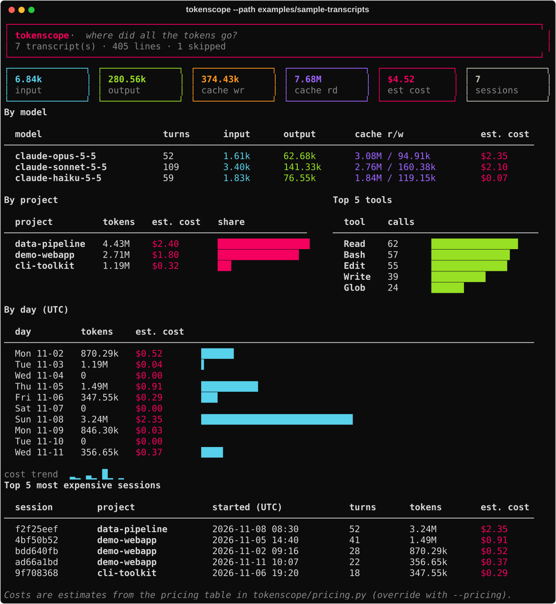
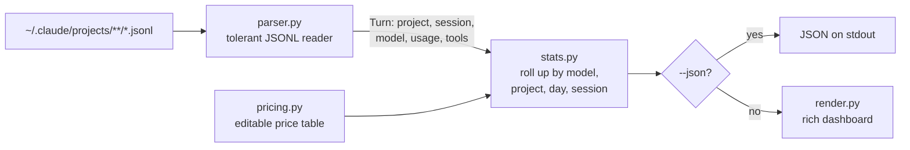

# tokenscope

<p align="center">
  
</p>

**Find out where your Claude Code tokens actually went: one command, one terminal dashboard.**

[](https://github.com/TGabeCar/tokenscope/actions/workflows/ci.yml)
[](LICENSE)
[](https://www.python.org/downloads/)

You talk to the model all day. The model talks back, reads half your repo, and quietly
re-reads a few million cached tokens. `tokenscope` reads the session transcripts Claude Code
already keeps on disk and shows you the bill-shaped picture: tokens by model, project and day,
your favourite tools, and the sessions that cost the most. Nothing leaves your machine.

## Demo

Run against the synthetic transcripts in [`examples/sample-transcripts`](examples/sample-transcripts):

```text
$ tokenscope --path examples/sample-transcripts
┌──────────────────────────────────────────────────────────────────────────────────────────────────┐
│ tokenscope  ·  where did all the tokens go?                                                      │
│ 7 transcript(s) · 405 lines · 1 skipped                                                          │
└──────────────────────────────────────────────────────────────────────────────────────────────────┘
┌──────────────┐ ┌──────────────┐ ┌──────────────┐ ┌──────────────┐ ┌─────────────┐ ┌──────────────┐
│ 6.84k        │ │ 280.56k      │ │ 374.43k      │ │ 7.68M        │ │ $4.52       │ │ 7            │
│ input        │ │ output       │ │ cache wr     │ │ cache rd     │ │ est cost    │ │ sessions     │
└──────────────┘ └──────────────┘ └──────────────┘ └──────────────┘ └─────────────┘ └──────────────┘
                                              By model

  model                         turns      input       output              cache r/w     est. cost
 ──────────────────────────────────────────────────────────────────────────────────────────────────
  claude-opus-5-5                  52      1.61k       62.68k         3.08M / 94.91k         $2.35
  claude-sonnet-5-5               109      3.40k      141.33k        2.76M / 160.38k         $2.10
  claude-haiku-5-5                 59      1.83k       76.55k        1.84M / 119.15k         $0.07

                        By project                                        Top 5 tools

  project         tokens   est. cost   share                  tool    calls
 ────────────────────────────────────────────────────────    ──────────────────────────────────────
  data-pipeline    4.43M       $2.40   █████████████████      Read       62   ████████████████
  demo-webapp      2.71M       $1.80   ███████████████        Bash       57   ██████████████▌
  cli-toolkit      1.19M       $0.32   ██▌                    Edit       55   ██████████████
                                                              Write      39   ██████████
                                                              Glob       24   ██████

                                            By day (UTC)

  day          tokens   est. cost
 ──────────────────────────────────────────────────────────────────────────────────────────────────
  Mon 11-02   870.29k       $0.52   ██████
  Tue 11-03     1.19M       $0.04   ▌
  Wed 11-04         0       $0.00
  Thu 11-05     1.49M       $0.91   ██████████▌
  Fri 11-06   347.55k       $0.29   ███
  Sat 11-07         0       $0.00
  Sun 11-08     3.24M       $2.35   ████████████████████████████
  Mon 11-09   846.30k       $0.03
  Tue 11-10         0       $0.00
  Wed 11-11   356.65k       $0.37   ████

cost trend  ▂▁ ▃▁ █▁ ▁
                                   Top 5 most expensive sessions

  session        project              started (UTC)               turns       tokens     est. cost
 ──────────────────────────────────────────────────────────────────────────────────────────────────
  f2f25eef       data-pipeline        2026-11-08 08:30               52        3.24M         $2.35
  4bf50b52       demo-webapp          2026-11-05 14:40               41        1.49M         $0.91
  bdd640fb       demo-webapp          2026-11-02 09:16               28      870.29k         $0.52
  ad66a1bd       demo-webapp          2026-11-11 10:07               22      356.65k         $0.37
  9f708368       cli-toolkit          2026-11-06 19:20               18      347.55k         $0.29

Costs are estimates from the pricing table in tokenscope/pricing.py (override with --pricing).
```

## Features

- **Totals at a glance:** input, output, cache-write and cache-read tokens, estimated cost, session count.
- **Per-model cost estimates** from a small pricing table you can edit in code or override with a JSON file.
- **Usage by project** (the transcript's parent folder) and **by day**, with bar charts and a cost sparkline.
- **Top tool calls** (`Read`, `Bash`, `Edit`, ...) counted from `tool_use` blocks.
- **Most expensive sessions**, ranked, with start time and turn count.
- **`--json`** for scripts, notebooks and spreadsheets.
- **Defensive parsing:** malformed lines are counted and skipped, odd values are ignored, and a message
  split across several lines has its usage counted once.
- **One dependency:** [`rich`](https://github.com/Textualize/rich).

## Install

```bash
pip install git+https://github.com/TGabeCar/tokenscope
```

Requires Python 3.10 or newer.

## Usage

```bash
# Everything under ~/.claude/projects (the default path)
tokenscope

# A single project folder or a single transcript file
tokenscope --path ~/.claude/projects/my-project
tokenscope --path path/to/session.jsonl

# Only this month, top 10 rows in each ranking
tokenscope --since 2026-11-01 --top 10

# Machine-readable output
tokenscope --json | jq '.by_model'

# Your own prices (USD per million tokens)
tokenscope --pricing my-prices.json
```

| Flag | What it does |
| --- | --- |
| `--path` | A transcript file or a folder searched recursively for `*.jsonl` (default `~/.claude/projects`). |
| `--since YYYY-MM-DD` | Only count turns on or after this date (UTC). |
| `--top N` | Rows in the tools and sessions rankings (default 5). |
| `--json` | Print JSON instead of the dashboard. |
| `--pricing FILE` | JSON file of model prices merged over the built-in table. |

A pricing file looks like this; any field you leave out keeps its built-in value:

```json
{
  "claude-opus-5-5": {"input": 4.0, "output": 20.0, "cache_write": 5.0, "cache_read": 0.2},
  "my-internal-model": {"input": 0, "output": 0}
}
```

## How it works



Assumed transcript fields (anything missing is skipped, never fatal):

| Field | Used for |
| --- | --- |
| `message.usage.input_tokens`, `output_tokens`, `cache_creation_input_tokens`, `cache_read_input_tokens` | token totals |
| `message.model` | pricing and the per-model table |
| `message.content[]` items with `type: "tool_use"` and a `name` | tool counts |
| `message.id` | counting a message's usage once when it spans several lines |
| `timestamp` (ISO 8601) | the per-day view and `--since` |
| `sessionId` | per-session ranking (falls back to the file name) |
| parent folder name | the project |

## Pricing disclaimer

Every dollar figure is an **estimate**. The prices live in
[`src/tokenscope/pricing.py`](src/tokenscope/pricing.py) as plain numbers per million tokens,
typed in by hand, and they will drift from the real price list over time. Unknown models fall
back to a default rate. Discounts, batch pricing, long-context tiers and subscription plans are not
modelled; if you are on a subscription, read the dollar column as "what this would have cost on
pay-as-you-go," not as money you spent. Override anything with `--pricing`.

## Development

```bash
python -m pip install -e . pytest
python -m pytest -q
python examples/generate_samples.py   # rebuild the synthetic transcripts
python scripts/make_demo.py           # rebuild docs/demo.svg
```

The sample transcripts are entirely invented: fake projects, fake prompts, deterministic random numbers.

## Roadmap

- `--watch` mode that refreshes the dashboard live while a session runs.
- Group by git branch or working directory, not just the project folder.
- CSV export and a weekly "budget" warning when spend crosses a threshold you set.

## License

[MIT](LICENSE) © 2026 Gabe
